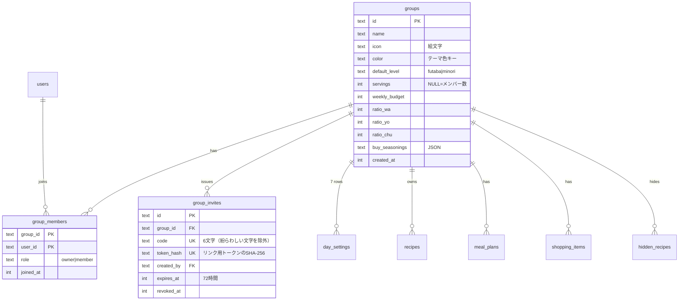

# 追加要望 変更計画 — グループ共有 & 料理レベル

作成日: 2026-10-18 / 対象: `C:\dev\kondate-app`（依頼書にある OneDrive 内のパスから移動済み）

## 0. 現状と方針

- 実装済み: フェーズ1〜4（土台・Google認証・デザインシステム・テーマ）。レシピDBを作成中。
- **本番環境はまだない**ため、移行が必要なのはローカルDBだけ。ただし本番と同じ手順で動く「既存データを壊さないマイグレーション」として作る。
- 献立・買い物・設定のAPIはまだ作っていない。そのため、最初から「グループ単位」で作る（後からの作り直しが発生しない）。

### 解釈を決めた点（違っていたら教えてください）

1. **料理レベルは「個人の好み」と「グループの既定」の2段構え**にする。
   - オンボーディングで選んだレベルは、個人設定（`user_settings.cooking_level`）に保存する。
   - そのレベルを、新しく作るグループの既定値として使う。
   - 献立生成で使うのは、**グループの既定値と、曜日ごとの上書き**。
2. **分量の人数**は、グループの `servings` が空ならメンバー数を使う。値を入れれば手動の人数になる。
3. **手順のタイマー**は、手順の文章（例：「10分煮る」）から自動で検出する。DBには保存しない。
4. **「みのり」は、すべてのレシピから選ぶ**。ただし、みのりのレシピの重みを1.6倍にする。
5. **競合の扱い**
   - 献立の編集は、各週の献立に付けた `version` で判定する。自分の画面が古いまま保存しようとしたら 409 を返し、再読み込みを促す。
   - 買い物リストのチェックは「チェックする／外す」を明示して送る方式にし、後から保存したほうを優先する。

---

## 1. DBスキーマの差分

| テーブル          | 変更内容                                                                                                                        |
| ----------------- | ------------------------------------------------------------------------------------------------------------------------------- |
| **groups**        | 新規。週予算・ジャンル割合・人数・買う調味料・既定レベルを `user_settings` から移す                                             |
| **group_members** | 新規。ロールは owner と member                                                                                                  |
| **group_invites** | 新規。招待コードとリンク用トークン（ハッシュで保存）、有効期限、取り消し日時                                                    |
| users             | `current_group_id` を追加（最後に使ったグループ）                                                                               |
| user_settings     | 個人設定だけを残す: `theme`、`cooking_level`（新規）。週予算などはグループへ移す                                                |
| day_settings      | `user_id` → `group_id`。`level`（`inherit`/`futaba`/`minori`）を追加                                                            |
| recipes           | `owner_id` → `group_id`（NULL＝システム共通）、`created_by` を追加、**`difficulty`** を追加。`steps` を `{text, tip?}[]` に変更 |
| hidden_recipes    | `user_id` → `group_id`                                                                                                          |
| meal_plans        | `user_id` → `group_id`。`version`、`updated_by`、`updated_at` を追加                                                            |
| meal_plan_items   | `updated_by`、`updated_at` を追加（変更箇所のハイライトと通知に使う）                                                           |
| shopping_items    | `user_id` → `group_id`。`checked_by`、`checked_at` を追加                                                                       |
| ai_usage          | 変更なし（ユーザー単位の制限のまま）                                                                                            |

### データ移行の方針（`0002_groups.sql`）

- SQLite では列名を変えられないため、「新しいテーブルを作る → データをコピー → 入れ替える」方式で移行する。外部キーを壊さない順番で行う。
- 既存ユーザー1人につき「◯◯の家」グループを1つ作り、そのユーザーを owner にする。`current_group_id` もそのグループにする。
- `user_settings` の週予算・割合・人数・調味料をそのグループにコピーする。`day_settings` と、ユーザーが作ったレシピをグループに付け替える。
- システムレシピ（作成者のいないもの）はそのまま残す。
- 移行のテストを追加する: 古い形式のDBにデータを入れてから新しいマイグレーションを当て、件数と紐づけが保たれていることを確認する。

---

## 2. API（新規・変更）

**グループ**: 全API共通で、`X-Group-Id` ヘッダー、なければ `current_group_id` のグループを使う。そのグループのメンバーかどうかを毎回確認し、メンバーでなければ 403 を返す。

| メソッド | パス                                | 内容                                              | 権限        |
| -------- | ----------------------------------- | ------------------------------------------------- | ----------- |
| GET      | `/api/groups`                       | 自分が所属するグループの一覧                      | ログイン    |
| POST     | `/api/groups`                       | グループ作成（自分が owner）                      | ログイン    |
| PATCH    | `/api/groups/:id`                   | 名前・アイコン・色・既定レベル・人数              | member      |
| DELETE   | `/api/groups/:id`                   | グループ削除（最後の1つは削除できない）           | owner       |
| POST     | `/api/groups/:id/switch`            | 使うグループを切り替え                            | member      |
| GET      | `/api/groups/:id/members`           | メンバー一覧（アバター・ユーザーネーム・ロール）  | member      |
| DELETE   | `/api/groups/:id/members/:userId`   | 除外（owner）／自分で退出（owner は譲渡してから） | owner／本人 |
| POST     | `/api/groups/:id/transfer`          | オーナー権限の譲渡                                | owner       |
| POST     | `/api/groups/:id/invites`           | 招待を発行（コード＋リンク、72時間有効）          | owner       |
| GET      | `/api/groups/:id/invites`           | 有効な招待の一覧                                  | owner       |
| DELETE   | `/api/groups/:id/invites/:inviteId` | 招待の取り消し                                    | owner       |
| GET      | `/api/invites/:codeOrToken`         | 参加確認の情報（グループ名・招待者・人数）        | ログイン    |
| POST     | `/api/invites/:codeOrToken/accept`  | 参加する                                          | ログイン    |
| GET      | `/api/groups/:id/live`              | **WebSocket**（Durable Object へ中継）            | member      |

**変更**

- `PATCH /api/me`: `cookingLevel` を追加。`GET /api/me` で現在のグループも返す。
- 献立・設定・買い物・レシピのAPI（これから作るもの）は、すべてグループ単位にする。
- 献立を編集するAPIは、リクエストに `version` を含める。古ければ 409 を返す。
- 生成API（`generate`／`regenerate`）は、ふたばの日の候補が足りないときに `warnings[]` を返す（例：「土曜のふたばの副菜が足りないため、最近使ったレシピも含めました」）。

---

## 3. リアルタイム同期（Durable Objects）

- `GroupRoom` という Durable Object を、グループごとに1つ置く。**WebSocket Hibernation API** を使い、接続を待っている間は課金されないようにする。
- 流れ:
  1. Worker の API が献立や買い物リストを更新したら、`GroupRoom` に変更を通知する。
  2. `GroupRoom` が、接続中のメンバー全員に配信する（例：`{type:'shopping.updated', by, items}`）。
  3. 各端末は TanStack Query のキャッシュを更新する。他の人が献立を変更した場合は、トーストで通知し、変更箇所をハイライトする。
- 通知は「変更があった」ことを知らせるだけにし、正しいデータはDB（D1）を正とする。届かなかったときも、再取得すれば正しい状態に戻る。
- **フォールバック**: WebSocket が切れている間は、TanStack Query が15秒ごとにデータを取り直す。再接続は少しずつ間隔を空けて試す。
- Durable Objects を採用する理由（READMEに記載する）: 同じグループの更新を1か所に集めるので、順序がそろう。Hibernation API で、待機中のコストもほぼかからない。
- 実装前に、Durable Objects と Hibernation API の最新ドキュメントを確認する。

---

## 4. 料理レベル

- レベルの名前と説明文は、定数ファイル `src/shared/levels.ts` の1か所で管理する（🌱ふたば／🌾みのり、「初級」「上級」という言葉は使わない）。
- **ふたばの基準**（シードのテストで自動チェックする）
  - 手順は5つ以内で、**全手順に初心者向けのひとことコツ**がある
  - 調味料以外の材料は7品目以内
  - 揚げ物・三枚おろしは含まない
- **ふたばの割合**: カテゴリ×ジャンルのどの組み合わせでも、ふたばのレシピを4割以上にする。今回は約5割で作る。
- **献立生成**
  - ふたばの日は、ふたばのレシピだけから選ぶ。
  - みのりの日は、すべてのレシピから選び、みのりのレシピを優先する。
  - 候補が足りないときは、①最近使ったレシピも選べるようにする → ②時間の条件をゆるめる → ③予算の条件をゆるめる → ④ジャンルの条件をゆるめる、の順で対応する。それでも足りなければ、その日のその品目は空欄にして warning で知らせる。

---

## 5. 画面の追加・変更

| 画面                   | 内容                                                                                                           |
| ---------------------- | -------------------------------------------------------------------------------------------------------------- |
| ヘッダー（ホームなど） | グループを切り替えるボタン（絵文字アイコン＋名前）。シートで一覧が開く                                         |
| 設定 → グループ        | 名前・アイコン・色・人数、メンバー一覧、招待（コード表示・リンクのコピー・取り消し）、退出・削除・譲渡         |
| `/invite/$token`       | 参加確認画面。未ログインならログインしてからこの画面に戻る                                                     |
| 「コードで参加」       | 6文字のコードを入力して参加する                                                                                |
| オンボーディング       | ユーザーネーム → **レベル選択**（カードがふわっと浮き上がる）                                                  |
| 週の設定               | 曜日ごとに「予算・時間・**レベル**・副菜」を並べる。グループの既定レベルも設定できる                           |
| レシピ一覧・詳細       | 🌱／🌾 のガラス調チップ（ふたばは芽がゆれる）、レベルでの絞り込み                                              |
| ふたばのレシピ詳細     | 「ゆっくりモード」（1手順ずつ大きく表示し、スワイプで次へ）、コツの吹き出し、「◯分」をタップで起動するタイマー |
| 買い物リスト           | チェックした人の小さなアバター                                                                                 |
| 全体                   | 他のメンバーが変更したときのガラス調トーストと、変更箇所のハイライト                                           |

---

## 6. フェーズの組み直し

| #      | フェーズ                                  | 内容                                                                                                                                                                                                         |
| ------ | ----------------------------------------- | ------------------------------------------------------------------------------------------------------------------------------------------------------------------------------------------------------------ |
| 5      | レシピDB＋初期シード110件                 | **難易度とコツを最初から入れる**。レシピのAPIと画面（レベルバッジ・絞り込み・ゆっくりモード・タイマー）                                                                                                      |
| 5.5    | **グループの土台（新規）**                | 移行マイグレーション、グループ・メンバー・招待のAPI、全APIのグループ単位の権限、オンボーディングでのレベル選択、グループの切り替えと管理画面、**権限テスト**（所属していないグループのデータが見えないこと） |
| 6      | 献立設定＋生成ロジック＋週間献立          | グループ単位で作る。曜日ごとのレベル、レベル条件のテスト                                                                                                                                                     |
| 7      | ホーム画面                                | 変更なし（現在のグループの今日の献立を出す）                                                                                                                                                                 |
| 8      | 買い物リスト                              | チェックした人のアバター                                                                                                                                                                                     |
| 9      | **リアルタイム同期（新規）**              | Durable Object、WebSocket、トーストとハイライト、ポーリングへのフォールバック、競合時の409                                                                                                                   |
| 10     | AIレシピ追加                              | 難易度とコツもAIに推定させ、確認画面で直せるようにする                                                                                                                                                       |
| 11〜14 | PWA化・GitHub公開・本番デプロイ・最終報告 | README に機能一覧と Durable Objects の採用理由を追記する。本番デプロイ時に Durable Object の設定も追加する                                                                                                   |
