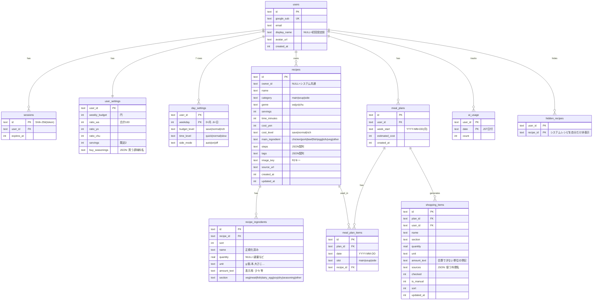

# フェーズ1 実装計画 — 週間献立 & 買い物リスト（kondate-app）

作成日: 2026-10-18

---

## 0. 事前確認の結果

| 項目 | 状況 | 対応 |
|---|---|---|
| Node.js | v24.21.0 / npm 11.19 | そのまま使用（パッケージマネージャは npm） |
| git | **未インストール** | フェーズ2の前に `winget install Git.Git` を案内 |
| gh CLI | **未インストール** | フェーズ11の前に `winget install GitHub.cli` → `gh auth login` を案内 |
| wrangler | 未導入（グローバル） | プロジェクトの devDependency として入れて `npx wrangler` で使う |
| 作業フォルダ | `01_共通` 直下に `04_献立アプリ` がある | **要確認**（下記「確認事項」） |

### 公式ドキュメントで確認したこと（2026-10-18時点）
- **Workers 静的アセット + SPA**: `wrangler.jsonc` の `assets.not_found_handling: "single-page-application"` と `assets.run_worker_first: ["/api/*"]` で、`/api/*` だけWorker（Hono）、それ以外はSPAを配信できる（Wrangler v4.20+ / Vite plugin v1.7+）。`compatibility_date` は作成日の日付にする。
- **Workers AI のビジョン対応モデル候補**: `@cf/meta/llama-4-scout-17b-16e-instruct`（画像対応・`guided_json` でJSONスキーマ指定可・131kコンテキスト）、`@cf/qwen/qwen3.8-27b`（画像対応・262k）、ほかに `mistral-small-3.1-24b-instruct`、`glm-5.3-flash`、`kimi-k2.6`。
  - 公式ページには日本語の品質についての記載がない → **フェーズ9で実際の日本語レシピ写真・ページで2〜3モデルを比較して決める**（決め打ちしない）。第一候補は llama-4-scout（`guided_json` が使えるため）。
  - モデルIDは `src/worker/ai/models.ts` の1か所に集約し、差し替えやすくする。
- **Arctic（Google OAuth）**: v3。Google は confidential client + PKCE（`generateState` / `generateCodeVerifier` → `createAuthorizationURL` → `validateAuthorizationCode`）。ドキュメント間でシグネチャの記載が食い違っているため、**インストールした版の型定義で確認してから**実装する。

---

## 1. 技術スタック（指定どおり。変更提案は以下のみ）

指定の構成をそのまま採用します。補足と小さな提案:

1. **IDトークンの検証**: Google のユーザー情報は、`validateAuthorizationCode` で取得した ID トークン（Google から直接 TLS 経由で受け取ったもの）をデコードして `sub` / `email` / `name` / `picture` を得る。追加のライブラリは不要。
2. **セッション**: ランダム32バイトのトークンを Cookie（`HttpOnly; Secure; SameSite=Lax`）に入れ、D1 には **SHA-256 ハッシュのみ**を保存する。有効期限は30日（スライディング）。
3. **タイムゾーン**: Workers は UTC で動くため、「今日」「週の開始」は **Asia/Tokyo 固定**で計算する（共通ユーティリティ）。週は**月曜始まり**。
4. **Drizzle + D1 マイグレーション**: `drizzle-kit generate` で SQL を生成 → `wrangler d1 migrations apply` で適用（ローカル / 本番とも wrangler に一本化）。
5. **Workers AI の無料枠**: 1日 10,000 Neurons。ユーザーごとのレート制限（例: 1日20回）を D1 で管理する。

---

## 2. ディレクトリ構成

```
kondate-app/
├─ wrangler.jsonc               # D1 / R2 / AI / assets バインディング
├─ vite.config.ts               # @cloudflare/vite-plugin, react, tailwind, pwa, tanstack-router
├─ drizzle.config.ts
├─ tsconfig*.json               # strict, app/worker/node を分割
├─ eslint.config.js / .prettierrc
├─ vitest.config.ts             # 純粋ロジック用（node）+ workers pool（API用）
├─ .dev.vars.example            # GOOGLE_CLIENT_ID / GOOGLE_CLIENT_SECRET / APP_URL
├─ .github/workflows/deploy.yml
├─ migrations/                  # drizzle-kit 生成SQL
├─ seed/
│  ├─ recipes/{main,soup,side}.{wa,yo,chu}.ts   # 初期レシピ110件
│  ├─ ingredient-aliases.ts     # 表記ゆれ辞書（玉ねぎ/たまねぎ/タマネギ…）
│  └─ build-seed-sql.ts         # → seed.sql を生成（wrangler d1 execute で投入）
├─ src/
│  ├─ shared/                   # フロント・バック共通
│  │  ├─ schemas.ts             # Zod（Recipe, Settings, Plan, ShoppingItem, AIドラフト）
│  │  ├─ constants.ts           # カテゴリ/ジャンル/材料区分/売り場順/段階
│  │  ├─ date.ts                # JST・週計算
│  │  ├─ planner/               # ★献立生成（純粋関数）+ テスト
│  │  ├─ shopping/              # ★買い物リスト集計（純粋関数）+ テスト
│  │  └─ normalize.ts           # 材料名の正規化 + テスト
│  ├─ worker/
│  │  ├─ index.ts               # Hono app（export type AppType）
│  │  ├─ db/schema.ts           # Drizzle スキーマ
│  │  ├─ middleware/            # auth, rate-limit, error
│  │  ├─ routes/                # auth, me, settings, recipes, images, ai, plans, shopping
│  │  ├─ ai/                    # models.ts, prompts.ts, extract-url.ts, extract-image.ts
│  │  └─ lib/                   # session, safe-fetch(SSRF対策), html-to-text
│  └─ app/
│     ├─ main.tsx / router.tsx
│     ├─ api.ts                 # hc<AppType> クライアント
│     ├─ routes/                # TanStack Router（ファイルベース）
│     ├─ components/
│     │  ├─ glass/              # GlassCard, GlassButton, GlassSheet, TabBar, Blobs
│     │  ├─ skeleton/           # 各画面のスケルトン
│     │  ├─ GenreRatioSlider.tsx
│     │  ├─ MealCard.tsx / RecipeForm.tsx / ShoppingRow.tsx …
│     ├─ hooks/ / lib/greeting.ts（挨拶文 + テスト）
│     └─ styles/ (tokens.css, glass.css)
└─ public/ (icons, manifest assets)
```

---

## 3. DBスキーマ（ER図）



- インデックス: `meal_plans(user_id, week_start)` UNIQUE、`meal_plan_items(plan_id, date, slot)` UNIQUE、`recipes(owner_id, category)`、`recipe_ingredients(recipe_id)`、`shopping_items(plan_id)`。
- **ユーザー分離**: 全クエリで `user_id = セッションのユーザー` を条件に入れる。レシピは `owner_id IS NULL OR owner_id = me`。システムレシピは編集・削除不可（「非表示」と「コピーして編集」は可能）。

---

## 4. API一覧（すべて `/api` 配下、auth以外はログイン必須）

| メソッド | パス | 内容 |
|---|---|---|
| GET | `/api/auth/google` | state・PKCEをCookieに保存してGoogleへリダイレクト |
| GET | `/api/auth/google/callback` | トークン交換 → ユーザー作成/更新 → セッション発行 |
| POST | `/api/auth/logout` | セッション削除 |
| GET / PATCH | `/api/me` | 自分の情報 / ユーザーネーム変更 |
| GET / PUT | `/api/settings` | 週予算・ジャンル割合・人数・曜日別設定・買う調味料 |
| GET | `/api/recipes?q=&category=&genre=&ingredient=` | 検索（名前・材料） |
| GET | `/api/recipes/:id` | 詳細 |
| POST / PUT / DELETE | `/api/recipes`, `/api/recipes/:id` | 自分のレシピのCRUD |
| POST | `/api/recipes/:id/hide`, `/copy` | システムレシピの非表示 / 複製 |
| POST | `/api/images` | 画像アップロード（R2、≤5MB、jpeg/png/webp） |
| GET | `/api/images/:key` | 画像配信（本人のもの、またはシステムのもののみ） |
| POST | `/api/ai/import-url` | URL → 安全な取得 → 本文抽出 → AI → レシピ下書き（保存はしない） |
| POST | `/api/ai/import-image` | R2キー → ビジョンAI → レシピ下書き |
| GET | `/api/today` | 今日の献立（ホーム用。ない場合は生成を促す） |
| GET | `/api/plans/:weekStart` | 週間献立 + 想定費用 + 予算超過フラグ |
| POST | `/api/plans/:weekStart/generate` | 週全体を生成 |
| POST | `/api/plans/:weekStart/days/:date/regenerate` | 1日分を再生成（`{slot?}` で品目単位） |
| PUT | `/api/plans/:weekStart/days/:date/:slot` | 手動でレシピを指定 / 削除 |
| POST | `/api/plans/:weekStart/swap` | `{from, to}` で曜日を入れ替え |
| GET | `/api/shopping/:weekStart` | 買い物リスト（なければ生成） |
| POST | `/api/shopping/:weekStart/regenerate` | 再生成（チェック状態は名前と単位で引き継ぐ） |
| POST / PATCH / DELETE | `/api/shopping/items`, `/:id` | 手動追加 / チェック切り替え / 削除 |

献立を変更したときは、買い物リストに「献立が変わりました・更新」バナーを出す（自動で上書きはしない）。

---

## 5. 献立生成ロジック（`src/shared/planner`、純粋関数）

入力: レシピ候補、曜日ごとの設定、ジャンル割合、週予算、直近3週の使用履歴、乱数シード（テストで固定するため）

1. **主菜のジャンル割り当て**: 7日分を割合から最大剰余法で配分（例: 和50/洋30/中20 → 4/2/1）してシャッフル。
2. **主菜の選択**（日ごと）:
   - 時間の段階で絞る（時短 ≤20分 / ふつう ≤40分 / じっくり は制限なし）。予算の段階も合うものに絞る。
   - 重み = 基本値 × 最近使ったかどうか（1週前 0.15 / 2週前 0.35 / 3週前 0.6）× 前日と主材料が同じなら 0.1。
   - 同じ週で使ったレシピは除外。候補がなくなったら条件を1段ずつゆるめる（時間 → 予算 → ジャンル）。
3. **汁物・副菜**: 主菜のジャンルと同じものの重みを×4。副菜の有無は `side_mode`、または auto のときは「時短 or 節約の日はなし」。
4. **予算調整**: 合計が週予算を超えたら、一番高い日の品目を安い候補に置き換えることを最大N回くり返す。それでも超える場合は `overBudget` を返して警告表示。
5. 費用はレシピの `cost_yen` × (人数 / レシピの人数) で計算。

テスト: 重複がないこと、ジャンル配分、時間制約、主材料が連日にならないこと、副菜の省略、予算内への調整、シード値による再現性、候補不足時のフォールバック、1日再生成で他の日が変わらないこと。

## 6. 買い物リスト集計（`src/shared/shopping`、純粋関数）

- 材料名を正規化（表記ゆれ辞書・ひらがな/カタカナ統一）して `(name, unit)` で合算。単位は g/kg、ml/L、大さじ/小さじ を換算。合算できないもの（`1個` と `100g` など）は `amount_text` に併記する。
- 区分が `seasoning` のものは除外（`buy_seasonings` に入っているものは除外しない）。
- 売り場順に並べる: 野菜 → 肉 → 魚 → 卵・乳製品 → 豆製品 → 乾物 → 調味料 → その他。`sources` に料理名を入れる。
- テスト: 合算、単位換算、併記、調味料の除外、人数によるスケーリング、再生成時のチェック状態の引き継ぎ。

---

## 7. 画面一覧

| ルート | 画面 | 主なアニメーション / スケルトン |
|---|---|---|
| `/login` | ガラス調ログイン（Googleボタン） | ブロブ背景、フェードイン |
| `/onboarding` | ユーザーネーム設定 | 入力欄がせり上がる |
| `/` | **ホーム＝今日の献立**（挨拶・3品カード・週/買い物への導線） | 挨拶フェード、カードのstagger、スケルトン |
| `/week` | 週間献立（7日 × 3品、再生成・入れ替え・差し替え） | シャッフル演出、ドラッグで持ち上がる→バネで収まる |
| `/week/settings` | 曜日別設定・週予算・3分割ジャンルスライダー | つまみに追従するバッジ、割合バーの伸縮 |
| `/shopping` | 買い物リスト（売り場別、タップ/スワイプでチェック） | チェックマークの描画、購入済みが下へ移動 |
| `/recipes` | 一覧・検索・フィルタ | stagger、スケルトン |
| `/recipes/$id` | 詳細（材料・手順・時間・費用） | カードからの共有要素遷移（layoutId） |
| `/recipes/new`, `/recipes/$id/edit` | 登録・編集フォーム | — |
| `/recipes/import` | AI取り込み（URL / 撮影・画像選択）→ 確認・編集 | 進行段階つきの解析中スケルトン |
| `/settings` | ユーザーネーム、人数、買う調味料、ログアウト | スケルトン |

下部のフローティングタブ: ホーム / 週間献立 / 買い物 / レシピ / 設定（週間の設定は「週間献立」から開く）。

---

## 8. セキュリティ・非機能

- **SSRF対策**（`safe-fetch`）: http/https のみ、ポートは80/443のみ。ホスト名がIPリテラルの場合はプライベート/ループバック/リンクローカル/CGNATのアドレスを拒否し、`localhost`・`*.internal` なども拒否する。リダイレクトは手動で最大3回、毎回検証する。タイムアウト10秒、本文の上限2MB、`text/html` のみ。
  （Workers の `fetch` は DNS解決後のIPを取得できないため、DNSリバインディングへの対策はホスト名の検証までとし、Cloudflareのネットワークから内部ネットワークへは到達しない点も合わせてREADMEに書く）
- 画像: クライアント側で長辺1600px・WebP/JPEGに縮小してから送る。サーバー側でも MIME（マジックバイト）と5MB上限をチェックする。
- AIの出力: Zodで検証し、失敗したら「エラー内容を伝えて1回だけ再試行」、それでも失敗した場合は取れた部分を下書きに入れて手入力で補ってもらう。
- レート制限: AIは1ユーザー1日20回（設定で変更可）。
- 秘密情報: `.dev.vars` は `.gitignore` に入れる。本番は `wrangler secret put` で登録する。

---

## 9. 開発フェーズ（指定どおり）

1. 計画（本書）← **今ここ**
2. 土台（Vite + React + Hono + Workers、Tailwind v4、D1/R2/AI、Drizzle、ESLint/Prettier、Vitest、git）
3. 認証（Google Cloud Console の設定手順を案内）
4. デザインシステム
5. レシピDB + 初期シード110件（件数・スキーマ検証テスト付き）
6. 献立設定 + 生成ロジック（テスト）+ 週間献立画面
7. ホーム画面
8. 買い物リスト
9. AIレシピ追加（モデル比較を含む）
10. PWA化・仕上げ
11. GitHub公開
12. 本番デプロイ + GitHub Actions
13. 最終報告

---

## 10. OneDrive と node_modules について

OneDrive の同期対象に `node_modules`（数万ファイル）や `.wrangler`（ローカルD1）が入ると、同期の負荷・ファイルロック・`EPERM` エラー・ビルドの遅延が起きやすくなります。個人用OneDriveは**フォルダ名を指定して同期から除外することが基本的にできません**。対策の案:

- **A（推奨）**: プロジェクトを OneDrive の外（例: `C:\dev\kondate-app`）に置く。コードは GitHub で管理するため OneDrive にある必要はない。
- **B**: 指定どおり OneDrive 内に置き、問題が出たら A に移す。
- **C**: OneDrive 内に置きつつ、`node_modules` を OneDrive 外へのジャンクション（`mklink /J`）にする（やや手間がかかる）。
